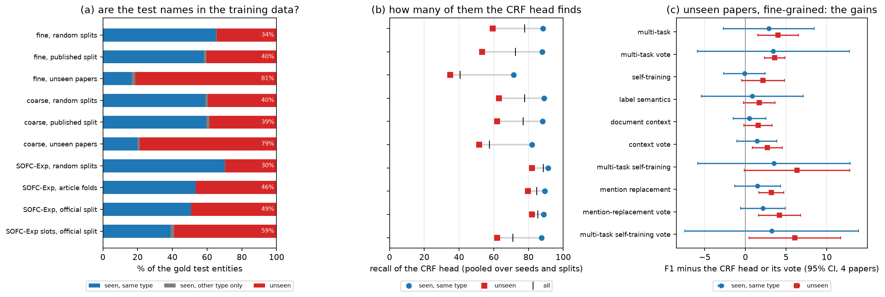
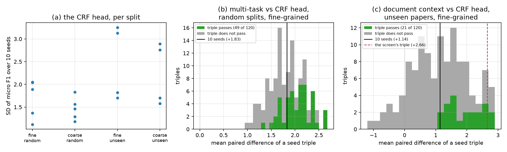
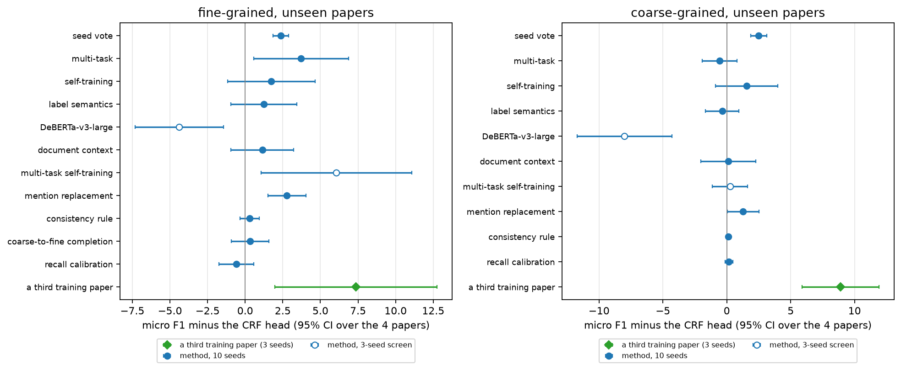

# Materials NER on unseen documents: a pre-registered evaluation on three corpora

*Anonymous TACL submission*

## Abstract

MaterioMiner, a materials-science named-entity recognition (NER) corpus of
four papers, is scored on random sentence splits, so its published score
measures known papers, not new ones. Under protocols committed before
their results, with 7 or 10 seeds and paired intervals over held-out
documents, we measure the overstatement on MaterioMiner and on two corpora
that hold out documents. MatSciBERT's CRF tagger scores 28 to 31 F1 points
lower on a held-out paper than on random splits fine-grained (17 to 20
coarse-grained), and 17 lower on a held-out MuLMS subfield, of which 9.5
return when its training sentences come from all other subfields; on
SOFC-Exp, one topic, 3.5 points are not established. Most test entities of
a new paper are names no training sentence annotates (81% on MaterioMiner,
88% on MuLMS); the tagger finds a third to two fifths of them. Of 118
pre-registered decisions, 27 pass, where about 3 would by chance; allowing
for shared training documents, 6 of the 18 passes paired over splits or
units keep their margin. Mention replacement passes on MaterioMiner's
held-out papers; four other additions are not shown to help. Four 3-seed
passes failed with 10 seeds. A fine-tuned generalist tagger,
GLiNER-medium, is not shown to beat the CRF tagger anywhere.

## 1 Introduction

Materials-science NER corpora are small. MaterioMiner
(durmaz2024materiominer) annotates 476 sentences from 4 fatigue papers
with an ontology of process, structure and property classes; its reported
MatSciBERT (gupta2022matscibert) F1 is 69.92 fine-grained (27 classes) and
72.32 coarse-grained on one random 65/15/20 sentence split, averaged over
5 seeds. An extractor in use meets new papers, not new sentences of known
ones, and random splits leak the papers' terms between training and test
(babl2025random; augenstein2017generalisation). SOFC-Exp
(friedrich2020sofc; 45 articles on one topic) and MuLMS
(schrader2023mulms; 50 articles from seven materials subfields) hold out
whole articles in their official splits; we compare all three.

We ask four questions, each answered under a protocol committed before
its results (for a few, part of the runs came first; Section 2;
vanmiltenburg2021preregistering):
1. How much is lost on a document the model has never been trained on, and
   where (Section 3)?
2. How far does a small-seed design mislead (Section 4)?
3. Which common additions improve materials NER on unseen documents once
   seeds are accounted for, and do they repeat on a second corpus
   (Sections 5 and 6)?
4. Does a generalist tagger do better (Section 7)?

Our runs are consistent with the published numbers. On a held-out
document MatSciBERT's CRF head scores 28 to 31 F1 points lower fine-grained on
MaterioMiner and 17 lower on MuLMS, of which 9.5 return
when the held-out models' training sentences come from all the other
subfields' articles; on SOFC-Exp the 3.5 points are not established. Most
of the fine-grained gap is unseen names the model misses outright; most of
the coarse-grained gap is boundaries and types (Section 3). A 3-seed
design passes a 1.8-point gain that passes with 10 seeds in only 41% of
seed triples, and the four 3-seed passes of stages 3 and 4 failed when
re-tested with 10 on GPUs (Section 4). Mention replacement passes on
MaterioMiner's held-out papers (its votes also on MuLMS's held-out
subfields), multi-task training on MaterioMiner's random splits, and seed
votes add 0.8 to 2.5 points wherever measured (reported); no method for
unseen documents that passed on one corpus is shown to improve on the CRF
head on SOFC-Exp. 118 pre-registered decisions, 27 passing, are counted in
Section 5.3. A third annotated paper adds as much on top of two papers as
the best method adds on top of three (exploratory); at equal sentence
counts it keeps about two fifths of its gain at both levels (re-decided on
7 fresh seeds), and the rest is its sentences (Section 6). A generalist
tagger, GLiNER-medium, fine-tuned on the same sentences, is not shown to
beat the CRF head on any corpus; with MaterioMiner's coarse types given as
unexpanded codes it is 10 points below there (Section 7).

A companion study (Anonymous, 2026) tests the method the programme arrived
at, mention replacement with six copies and names harvested from unlabeled
text, and finds most of its gain to be three-copy mention replacement's,
the names' increment not established (Section 5.2).

## 2 Setup

**Corpora and protocols** (Table 1). MaterioMiner's two levels nest: a
fine-grained entity is a coarse-grained entity with the same span.
SOFC-Exp's slot types refine its entity types on the same tokens. Its test
articles are tokenized differently from its training articles (`cm − 2`
for `cm−2`), which any model trained and tested on the released files
carries (Appendix A.1). 32.9% of MuLMS's entities lie
inside or on the span of another; we keep the outermost ones, so our
scores cannot be compared with the published MatSciBERT-CRF (79.6 micro
F1), which is scored on all of them. On MuLMS the models train on 340
sentences, about MaterioMiner's training size: for a held-out subfield,
from two or three whole articles of the other subfields; for a random
split, from all 50 articles.

| | MaterioMiner | SOFC-Exp | MuLMS |
|---|---|---|---|
| Documents | 4 fatigue papers (41, 81, 201 and 153 sentences) | 45 articles, one topic | 50 articles, 7 subfields |
| Entities | fine-grained: the 27 most frequent classes (1,328); coarse-grained: 27 types (2,194) | 4 entity types (4,590); 17 scored slot types (3,172) | 13 types; the outermost 31,952 of 46,584 |
| Splits | 5 random 65/15/20 sentence splits; the released split (323 / 57 / 96, undocumented) | 5 random 65/15/20 sentence splits; the official split, 26 / 8 / 11 articles | 5 random splits of a 400-sentence pool |
| Held-out unit | 1 paper (234–370 training sentences) | 9 articles, 5 folds | 1 subfield (351–2,384 test sentences) |

**Table 1.** The corpora and their protocols.

**Systems.** The encoder is MatSciBERT (gupta2022matscibert) with a token
classifier on the first sub-word of each word; the CRF head adds a
linear-chain CRF with IOB2 transition constraints
(lafferty2001conditional; lample2016neural) and is the reference of every
decision from stage 5 on. A seed vote keeps the entities predicted by at
least 2 of 3 seeds; multi-task training puts a fine-grained and a
coarse-grained CRF head on one encoder (on SOFC-Exp, an entity head and a
slot head). Section 5 tests label semantics (ma2022label), self-training
(liang2020bond), document context (schweter2020flert), document-level
label propagation (gale1992one; krishnan2006effective), mention
replacement (dai2020analysis), larger encoders (he2023debertav3) and
others; Appendix A.2 and A.3 give the settings. The encoders' pre-training
texts may contain test articles, so "never seen" holds for fine-tuning.

**Stages and seeds.** A stage is one round of runs under its own protocol,
committed before its results; stages 1 to 21 ran over one month (Table
A1). Stages 1 and 2 used one run per split, stages 3
and 4 three seeds. From stage 5 on, every system has 10 model seeds per
split (offsets 0 to 900), except the 3-seed screens and ablations, stage
8's 3-seed design, the MuLMS decisions on the seven seeds the screen did
not see (300–900, the decision seeds) and stage 20's re-decisions of stage
8 on the same fresh seeds.

**Scoring and the decision rule.** We score entity-level micro F1 with
seqeval (nakayama2018seqeval) in its default (conlleval) mode, as the
dataset's code does (tjongkimsang2003introduction). A change improves on
its reference only if the 95% Student-t confidence interval of the mean
paired micro-F1 difference lies above 0 (a paired t test;
dror2018hitchhiker). The pairs are splits or held-out
units, each side the mean of its seeds, or, on SOFC-Exp's official split,
the seeds, an interval conditional on that split's articles. With 4 papers
the interval has 3 degrees of freedom, with 5 folds 4, with 7 subfields 6,
so a gain must be consistent across units to pass. It treats the units as
independent, though they share training documents (Section 5.3), and
with 4 or 5 units no exact sign-flip test can reach the one-sided 2.5%
level, so a pass there also rests on the t distribution's assumption of
normality. A pooled decision takes the units of two corpora together
and requires, in addition, that neither corpus's own interval lie below 0.
Each protocol states the false passes expected if nothing works (2.5% of
its decisions). Square brackets give such an interval: after a difference,
over the units named (or seeds or draws where stated); after a score, over
its splits, units or seeds. A *screen* (3 seeds) chooses what to decide
and is never a result; a *reported* comparison is named in a protocol
without a decision; a *post hoc* analysis is chosen after the results, and
an *exploratory* one has no protocol.

**Pre-registration and runs.** Each protocol was committed before its
results, and before its runs but for stage 14's (pushed just after its
first batch) and D5 as executed (its MuLMS means include screen runs under
way when the pooled decision was added). Some sides were stored runs whose
results were known: stage 5's re-tests kept stage 4's seeds, and stored
runs formed the names' side of stages 14 and 18, the article pool of 20.1
and the CRF head of stage 21. Every decision from stage 5 on rests on
deterministic GPU runs, and the two machines are never compared within a
decision (Appendix A.8).

**The count and the release.** Section 5.3 counts every decision of stages
2 to 21; stage 1's comparisons have no protocol and are left out. The
code, the protocols as committed before each stage, every results file and
the test predictions of every GPU run behind a decision will be released
on publication.

## 3 The gap and its anatomy

### 3.1 Our runs are consistent with the published numbers

On the released split, scored like the dataset's code, plain MatSciBERT
scores 70.19 [69.03, 71.35] fine-grained and 72.52 [71.88, 73.16]
coarse-grained over 10 seeds. Both published numbers, 69.92 and 72.32, lie
inside these intervals. Single runs range over 4.6 points fine-grained
(68.0–72.7) and 3.6 coarse-grained (70.4–74.1), so a 5-seed mean of one
split is a noisy reference.

### 3.2 The gap on three corpora

The seed vote of the CRF head scores 79.68 fine-grained and 78.63
coarse-grained over 5 random splits, but 48.81 and 61.10 on a held-out
paper (Table 2). Every system with 10 seeds on both protocols scores 28–31
points lower fine-grained and 17–20 coarse-grained; no addition with runs
on both protocols narrows the gap by more than a few points.

The gap is smaller where held-out documents bring fewer new names. SOFC-Exp's 45 articles
share one topic and one annotation scheme. There the CRF head scores 86.27
[84.82, 87.71] over 5 random splits and 82.79 [78.33, 87.24] over 5 folds
of 9 held-out articles: a gap of 3.48 points, not established (Welch 95%
interval [−0.90, +7.86]; post hoc). A held-out SOFC-Exp article brings
fewer new names, and the CRF head finds 80% of them; about two of the
three and a half points are boundaries (under any overlap the gap is
1.35).

On MuLMS the CRF head scores 65.72 [65.25, 66.19] over 5 random splits and
48.66 [40.91, 56.40] over the 7 held-out subfields, a gap of 17.06 points
(Welch 95% interval [+9.31, +24.81]; post hoc). The gap mixes the change
of topic with fewer training documents at equal size, and stage 20 split
it (decision 20.1). Drawn by sentence from all the other subfields'
articles instead of from two or three whole articles, the 400 pool
sentences raise the CRF head to 58.17 [54.67, 61.67]: +9.51 [+1.12,
+17.91] over the 7 subfields (10 seeds), every subfield gaining; with the
post hoc allowance for pools that share articles, the interval is [−0.57,
+19.60]. The sentence pool also differs in its subfields (all six against
one to three) and its validation sentences. It lowers the share of unseen
test names from 88% to 75% and raises recall on unseen names from 39.4 to
52.6. The remaining 7.55 points (Welch [+4.05, +11.05]) set an unseen
subfield's documents against seen documents' sentences: topic shift and
document novelty together, with the test sets' composition, not separated
here.

| Corpus | Held-out unit | Random splits | Held-out documents | Gap | Unseen test names, held out / random |
|---|---|---|---|---|---|
| MaterioMiner, fine-grained (CRF vote) | 1 of 4 papers | 79.68 | 48.81 | 30.9 | 81% / 34% |
| MaterioMiner, coarse-grained (CRF vote) | 1 of 4 papers | 78.63 | 61.10 | 17.5 | 79% / 40% |
| MuLMS (CRF head, 340 training sentences) | 1 of 7 subfields | 65.72 | 48.66 | 17.1 | 88% / 57% |
| SOFC-Exp (CRF head) | 9 of 45 articles | 86.27 | 82.79 | 3.5 | 46% / 30% |

**Table 2.** The gap in micro F1 and the share of unseen test names
(Section 3.3); MaterioMiner's rows are the CRF head's seed vote (the head
alone: gaps of 31.0 and 18.4, Section 3.4).

### 3.3 Unseen documents are mostly unseen names

Following augenstein2017generalisation, a gold test entity is *seen* if
its exact words are an entity of the same type in the run's training
sentences and *unseen* if they are no entity there; a third kind, seen
with another type only, holds 0–2% of the entities (exploratory; all seeds
and units pooled; Figure 1).
- **The mix.** On random splits, 34% of the fine-grained test entities are
  unseen (coarse-grained 40%): random sentence splits put a paper's names
  on both sides, as babl2025random find for other corpora. On a held-out
  paper, 81% are unseen (coarse-grained 79%).
- **Missed outright.** Fine-grained, the CRF head misses 36% of the gold
  entities outright on unseen papers (10% on random splits).
  Coarse-grained, it misses only 6%, but 16% of the gold entities get the
  right span and the wrong type, and 21% a wrong boundary.
- **Unseen names in a new paper are harder.** Fine-grained, the CRF head
  finds 88% of the seen and 59% of the unseen entities of a random split,
  but 71% and 35% of those of a held-out paper (coarse-grained, 89% and
  63% against 82% and 52%). Its fine-grained recall falls from 77.8 to
  40.6; the mix and the lower recall within each kind each account for
  40–60% of that gap, in either order of the decomposition.
- **The other corpora.** 49% of SOFC-Exp's official test entities are
  unseen, and the CRF head finds 82% of them. On MuLMS's held-out
  subfields it finds 39% of the unseen names (66% of the seen), and their
  larger share accounts for about a third of its 22.5-point recall gap.
- **The gains show on unseen names.** Paired over the 4 held-out papers
  (fine-grained), every gain whose interval clears 0 overall also clears
  it on unseen names, but for six-copy mention replacement (+2.98 [+0.09,
  +5.86] overall, +3.65 [−0.15, +7.46] unseen). Seen names are about a
  sixth of a new paper's entities, so their intervals are wide: only mention
  replacement on the multi-task model (+5.88 [+0.42, +11.34]) and stage
  11's names (+2.66 [+0.03, +5.29]) clear 0 there.

A method for unseen documents therefore has to raise F1 on names the
training documents do not contain; whether the gains are larger there than
on seen names, the seen names' wide intervals do not tell.



**Figure 1.** (a) Shares of seen, seen-with-another-type and unseen gold
test entities. (b) The CRF head's recall on seen and unseen names. (c) On
held-out papers, fine-grained, each method's gain over the CRF head (a
vote's over the seed vote) on seen and unseen names, with 95% intervals;
"silver names" are stage 11's.

### 3.4 Found, but cut differently

seqeval counts a prediction only if its span and type are exactly those of
a gold entity. Under the looser criteria of SemEval-2013 Task 9.1
(segurabedmar2013semeval), each gold entity matched at most once
(exploratory), the CRF head's coarse-grained gap of 18.4 points shrinks to
9.7 when only the span must match and to 2.6 under any overlap: on a new
paper the model finds almost every entity, and loses mostly on where the
boundaries go and which type applies. Fine-grained, the gap shrinks from
31.0 to 25.0 and 18.3; there the model misses entities outright. On
held-out papers, 31% of the fine-grained predictions overlap a gold entity
but differ in span or type (13% on random splits). The gold annotations
differ too: only 35 fine-grained names are entities in two or more papers,
and 7 of them take different types. Part of what looks like a failure to
generalize may be a difference in annotation conventions between papers
(a hypothesis; we did not adjudicate the annotations).

### 3.5 A uniform decoding bias does not help

On unseen papers the CRF head predicts too few entities. A natural repair
adds a bias D to the emission score of every tag but O before Viterbi
decoding, trading precision for recall (lipton2014optimal; minkov2006ner);
we chose D per held-out paper on inner folds, without the paper's labels,
and per run on SOFC-Exp's validation articles. It is not shown to help: −0.59
[−1.75, +0.57] fine-grained and +0.17 [−0.14, +0.48] coarse-grained on the
4 held-out papers, −0.21 [−0.58, +0.17] on SOFC-Exp. The missed entities
are not near the threshold. Pooled over papers and seeds, fine-grained, D
= +0.25 adds 358 predictions, of which 22% are right, where the break-even
rate for F1 is F1/2 = 23%; coarse-grained and on SOFC-Exp the added
entities are right 19% and 21% of the time, below break-even (29% and
42%). A uniform bias does not recover the missed entities.

## 4 Seeds and machines

One split's micro F1 varies over the 10 seeds with a mean SD of 1.5–1.7
points on random splits and 2.2–2.5 on unseen papers (Figure 2a). The seed
vote, a three-model ensemble reported rather than decided, gains wherever
we measured it: +2.20 and +1.67 over the mean single CRF run on the random
splits, +2.36 and +2.50 on unseen papers, every interval above 0; on MuLMS
the CRF votes score 50.54 against the head's 48.66, and on SOFC-Exp 85.13
against 83.75 on the official split. From the 120 seed triples of the
10-seed runs, the 1.83-point multi-task gain passes in 41% of the triples
(49 of 120), and up to 37% of triples give the sign opposite to the
10-seed difference; that pass itself loses its margin under the corrected
resampled test (Section 5.3).

Of the 22 decisions of stages 3 and 4, taken with 3 seeds, four passed:
label semantics coarse-grained on unseen papers (+1.17 [+0.94, +1.41]),
multi-task training coarse-grained on random splits (+0.75 [+0.10, +1.39])
and the label-semantics vote coarse-grained on unseen papers (+1.63
[+0.11, +3.16]), all three on CPUs, and self-training fine-grained on
unseen papers (+1.07 [+0.33, +1.80]), on GPUs. Re-decided with 10 seeds on
GPUs in stage 5, none of the four passed (−0.36 [−1.66, +0.94], +0.71
[−0.15, +1.56], −0.63 [−1.72, +0.46] and +1.74 [−1.16, +4.64]). For the
three CPU passes the re-test changed the machine as well as the seeds:
recomputed from the GPU runs of the same seeds 0, 100 and 200 (post hoc),
they already fail (+0.07 [−2.47, +2.61], −0.08 [−1.71, +1.55] and +0.40
[−1.36, +2.16]). Only for self-training did the re-test keep the machine. The
same configuration and seed differ between the two machines by a median of
1.43 F1 points over 186 matched runs, and no pair is identical (post hoc):
a 3-seed interval on one machine misses run-to-run variation that another
machine, or more seeds, exposes.

The stage-6 screen shows the same: document context passed it
with +2.66 [+0.91, +4.40] fine-grained, and on the 7 seeds the screen did
not use it gains +0.49 [−3.10, +4.07] (post hoc); only 21 of its 120
triples pass. Screens then only chose what to run with 10 seeds, though
the decisions of stages 6 and 7 still averaged in the screen's three
seeds.



**Figure 2.** (a) The CRF head's SD over 10 seeds, per split. (b, c) The
mean differences of the 120 seed triples, fine-grained, for multi-task
training on random splits and document context on unseen papers, against
the 10-seed difference.

## 5 The additions, tested

Each addition is decided against the CRF head on held-out documents, and
its vote against the strongest system on unseen papers; a methods claim
also needs its gain to repeat on a second corpus. Tables B1 to B3 list the
decisions.

### 5.1 What holds, and where

**The CRF head** gains +3.12 and +2.96 over plain MatSciBERT on the
published split; under strict IOB2 scoring the gain shrinks to +1.70
[+0.21, +3.19] and +1.07 [−0.82, +2.97], so much of it comes from
predicting only valid spans. On SOFC-Exp it gains +1.22 [+0.50, +1.93]. On
test articles cut into words as the training articles are, its 84.61
[83.89, 85.34] covers the published MatSciBERT-CRF score (84.77;
gupta2022matscibert), which its 83.75 [82.85, 84.65] on the released test
files does not, and its gain falls to +0.17 [−0.37, +0.70]: it mostly
repairs the tokenization shift, whose two measurements pass (+0.86 [+0.39,
+1.33] for the CRF head, +1.91 [+1.33, +2.49] for plain MatSciBERT).

**Multi-task training** is the one training change that holds on
MaterioMiner's random splits, +1.83 [+0.32, +3.34] fine-grained
(coarse-grained +0.71 [−0.15, +1.56], no), and its vote improves on the
seed vote coarse-grained there (+0.79 [+0.17, +1.42]) and fine-grained on
unseen papers (+3.65 [+0.49, +6.82]). On SOFC-Exp's two levels it is not
shown to gain (−0.78 [−2.39, +0.84] on the slot types, −0.15 [−1.36, +1.05] on the
entity types).

**Mention replacement** (dai2020analysis) makes three copies of each
training sentence with an entity, each mention replaced with probability
0.5 by a training mention of the same type. Screened with 3 seeds and
decided with 10 only because the screen's mean was positive (+3.25 [−2.33,
+8.82]), it improves on the CRF head on MaterioMiner by +2.77 [+1.51,
+4.03] fine-grained and +1.28 [+0.06, +2.51] coarse-grained, every
held-out paper gaining (the decision averages in the screen's three seeds;
on the other seven, post hoc, +2.57 [+0.10, +5.03] and +1.73 [−0.63,
+4.08]). On SOFC-Exp it does not pass, on the official split (−0.29
[−1.04, +0.47]), over the folds (−0.48 [−1.36, +0.39]) or at
MaterioMiner's size (+0.50 [−0.47, +1.46]). On MuLMS the single model
gains +2.10 [−0.31, +4.51] and its votes +2.71 [+0.22, +5.20], which
passes. By the pre-registered criterion, it stays a MaterioMiner result.

**On the multi-task model**, mention replacement gains, on MaterioMiner,
+3.01 [+0.42, +5.60] fine-grained and +2.30 [+0.49, +4.10] coarse-grained
over the multi-task model and +6.73 [+6.03, +7.43] fine-grained over the
CRF head, the sum of its parts; its vote gains +2.86 [+0.18, +5.54] over
the multi-task vote. It is not shown to gain on SOFC-Exp. 3 of its 7 decisions
pass, where about 0.18 would by chance: a result for training sets of a
few papers with two type levels.

**Document-level label propagation** (Appendix A.3) passes coarse-grained
on MaterioMiner (+0.12 [+0.01, +0.24]) and on MuLMS (+0.82 [+0.18, +1.46],
13.1a), and loses on SOFC-Exp's official split (−0.42 [−0.61, −0.22]),
whose annotators leave 14% of a term's repeated occurrences untagged. It
is a two-corpus claim only under the criterion revised in stage 13 (stage
7's protocol required SOFC-Exp), and the effect is under a point.

**Not shown to help** with 10 seeds: label semantics (+1.23 [−0.96, +3.42]
fine-grained on unseen papers), self-training (+1.74 [−1.16, +4.64]),
document context (+1.14 [−0.94, +3.22]), multi-task self-training (+5.47
[−0.74, +11.68]; three papers gain 4–9 points and the fourth +0.51, and
its screen's gain held at about +5.2 on the 7 seeds it did not see, post
hoc, so this is a possible gain the design cannot confirm, not one it
inflated), recall calibration and coarse-to-fine completion (+0.34 [−0.91,
+1.59]). DeBERTa-v3-large's 3-seed screen, at MatSciBERT's untuned
learning rate, did not pass (−4.4 and −8.0 on unseen papers).

### 5.2 Names from unlabeled text

The companion study (Anonymous, 2026) harvests the names a new document
brings: three CRF teachers tag 40,000 unlabeled sentences on the held-out
documents' topic, and the mentions all three tag alike, every marginal at
least 0.9, enter training through mention replacement with six copies
(MR6; with three, MR3). Of its twelve decisions (Table B2), four pass: two
on MaterioMiner (+4.27 [+1.39, +7.15] fine-grained), a pooled one (+3.58
[+0.95, +6.21]) whose criterion was adopted when MR3 already met it, and
recall on the unseen names the lexicon holds (+11.24 [+3.31, +19.18]),
which passes only with three subfields no decoding bias matched and whose
outcome was chosen after a post hoc split had found the effect. On the
pooled decision's units and seeds MR3 alone gains +2.35 [+0.94, +3.75]; on
the 11 units with MuLMS's decision seeds the names add +0.80 [−0.66,
+2.26] over MR6 (D7). A lexicon ranked by a graph network failed its gate
(stage 19; Table A1).

### 5.3 The count

Through stage 21 the programme took 118 pre-registered decisions (stages
15, 16 and 19 took none), 15 three-seed screens (8 in Table B1, counted
per granularity, and the companion study's 7) and stage 19's lexicon
screen, which failed. 27 decisions pass, where about 3.0 would if nothing
worked: none of the 6 with one run per split; 6 of the 24 with 3 seeds (4
of the 22 of stages 3 and 4, none of which survived its 10-seed re-run,
and stage 8's 2 on a third paper, re-run in stage 20); and 21 of the 88
with 7 or 10 seeds (Table 3), none of them stage 21's.

| Addition | Decisions | Pass | Where it holds | Margin kept with the dependence allowance (post hoc) | Passes BH at 5% (post hoc) |
|---|---|---|---|---|---|
| CRF head over plain MatSciBERT | 1 (SOFC-Exp's official split) | 1 | MaterioMiner (reported) and SOFC-Exp, mostly a tokenization repair; half the gain is span validity | paired by seed | no |
| seed vote | none (reported) | — | adds 0.8 to 2.5 points wherever measured | — | — |
| multi-task training | 6 on MaterioMiner (4 on random splits), 2 on SOFC-Exp | 3 / 0 | MaterioMiner only | none | none |
| mention replacement | 4 on MaterioMiner, 2 on MuLMS, 3 on SOFC-Exp | 2 / 1 (votes) / 0 | MaterioMiner; MuLMS by vote | fine-grained MaterioMiner | none |
| mention replacement on the multi-task model | 4 on MaterioMiner, 3 on SOFC-Exp | 3 / 0 | MaterioMiner only | none | none |
| harvested names (stage 11; D1 to D12) | 16: 7 on MuLMS, 6 on MaterioMiner, 2 pooled, 1 on SOFC-Exp | 4 (D3, D4, D5, D11) | MaterioMiner, and pooled with MuLMS under a criterion adopted mid-study; on MuLMS alone only on recall, with three subfields unmatched; not over MR6 in F1; not SOFC-Exp | D4, D5, D11 | none |
| label propagation | 10: 6 on MaterioMiner, 2 on MuLMS, 2 on SOFC-Exp | 2 | MuLMS and coarse-grained MaterioMiner; loses on SOFC-Exp | MuLMS (13.1a) | none |
| label semantics, self-training, document context, multi-task self-training, recall calibration, coarse-to-fine | 28, 2 of them on SOFC-Exp | 0 | nowhere | — | — |
| SOFC-Exp's test articles re-cut (a measurement) | 2 | 2 | — | paired by seed | both |
| MuLMS's pool by sentence; a third paper at equal size, fresh seeds (measurements, stage 20) | 3 | 3 | MuLMS; MaterioMiner at both levels | the coarse-grained third paper (fixed in the protocol) | not tested |
| GLiNER-medium fine-tuned (stage 21) | 4: 2 on MaterioMiner, 1 on MuLMS, 1 on SOFC-Exp | 0 | nowhere above the CRF head; below it at MaterioMiner's coarse level, whose types it was given as codes | no pass; 21.2 stays below | not tested |

**Table 3.** Decisions with 7 or 10 seeds, by addition (8 on
MaterioMiner's random splits). The two right-hand columns are post hoc for
stages 2 to 18; stages 20 and 21 fixed their dependence reading in their
protocols and are not in the Benjamini–Hochberg test.

Three post hoc readings qualify the 24 passes of stages 2 to 18; none
changes a verdict. Stage 20's three passes carry the reading fixed in
their protocol (the coarse-grained third paper keeps its margin, the
other two lose it); stage 21 has none, and 21.2 stays below.
- **Shared training documents.** The companion study's model of the units'
  dependence (Anonymous, 2026; Appendix A.5) and, on random splits, the
  corrected resampled test (nadeau2003inference) widen the intervals by a
  factor of 1.2 to 1.6: of the 15 passes over units with 7 or 10 seeds, 5
  keep their margin, 6 of 18 with stage 20's (Table 3).
- **Multiplicity.** About 2.8 of the 24 passes are expected by chance, a
  false-discovery share near 12%. Under Benjamini–Hochberg control of the
  111 one-sided P values (benjamini1995controlling), 3 pass at a 5%
  false-discovery rate (SOFC-Exp's two tokenization measurements and stage
  3's CPU label-semantics pass, which did not replicate) and 12 at 10%;
  within each addition's family (Holm, family-wise 2.5%), 6 survive, none
  of them a method for unseen documents with 7 or 10 seeds.
- **Power.** Before their data, the single-model decisions on held-out
  papers could detect 0.4 to 3.8 points at 80% power (multi-task
  self-training's fine-grained one 8.1). After them, each failure is read
  by its interval: "not shown", with the upper bound as the largest gain
  the data allow (Tables B1 to B3), not "no effect".
- **Deviations.** Not every decision is confirmatory in the strict sense:
  the pooled names decision's criterion was adopted when three-copy
  mention replacement already met it, and three decisions would not have
  run under the original one; the recall decision's outcome followed a
  post hoc split; label propagation's criterion was revised in stage 13;
  stages 6 and 7 averaged in the screen's seeds; stage 14's protocol came
  just after its first batch; and stage 5's re-tests reused known seeds
  (Section 2, Table B2).

## 6 Data against method

The inner folds of Section 3.5 train the CRF head on two papers. On each
held-out paper, training on all three other papers instead adds +7.36
[+1.98, +12.74] F1 fine-grained and +8.90 [+5.90, +11.90] coarse-grained,
over 4 papers and seeds 0–200 (exploratory); every paper gains. A
pre-registered run trains on three papers cut to the size of two. At the
same number of sentences the third paper adds +1.18 [+0.22, +2.15]
fine-grained and +3.59 [+1.59, +5.58] coarse-grained on stage 8's 3 seeds.
Stage 20 re-decided both on seeds 300–900, which stage 8 had not seen
(decisions 20.2 and 20.3): at equal size the third paper adds +4.03
[+1.06, +7.00] fine-grained and +3.52 [+1.32, +5.72] coarse-grained, again
on every paper, and its own sentences +6.19 [+0.21, +12.17] and +5.10
[+3.57, +6.64]. With the post hoc allowance for shared papers, the
fine-grained interval reaches −0.51 and the coarse-grained one keeps its
margin ([+0.16, +6.88]). By point estimate, diversity is about two fifths
of the gain at both levels on the fresh seeds (a sixth fine-grained on
stage 8's 3).

On top of two papers, a third adds about as much as the largest method
gains measured on top of three (mention replacement on the multi-task
model, +6.73 fine-grained, Figure 3; with six copies and harvested names,
+7.49 [+5.96, +9.02], reported in stage 17). The baselines differ, the
third paper's 3-seed gain is exploratory, and annotation cost is not
weighed.



**Figure 3.** Each method's micro-F1 difference from the CRF head on the 4
held-out papers, with 95% intervals: 10 seeds, or a 3-seed screen
(hollow), and last a third training paper (3 seeds, exploratory).

## 7 A generalist baseline

Stage 21 tests a generalist tagger, which need not depend on the training
documents' names: GLiNER-medium v2.1 (zaratiana2024gliner), an open-weight
span model pre-trained to tag any label set it is given by name, on a
base-size encoder (DeBERTa-v3-base), chosen because it fits a free T4 GPU.
Its protocol was fixed before any run, after every held-out result of the
CRF head was known.

A zero-shot arm runs once per unit on MaterioMiner fine-grained, MuLMS and
SOFC-Exp's folds, its threshold chosen on validation micro F1; a
fine-tuned arm trains on the CRF head's training sentences, splits and 10
seeds, with a fixed recipe and threshold 0.5. The labels are the types'
names in words (e.g. "stress amplitude"; Appendix A.7). MaterioMiner's
coarse-grained types have no documented names and enter as their codes
lowercased (e.g. "mec"), so that level has no zero-shot arm.

Decisions 21.1–21.4 take the fine-tuned model minus the CRF head, each
unit the mean of its 10 seeds, paired over MaterioMiner's papers
fine-grained (21.1) and coarse-grained (21.2), MuLMS's subfields (21.3)
and SOFC-Exp's folds (21.4), with about 0.1 false passes expected. The
protocol expected a null to bound effects of about 4–5 points on
MaterioMiner, 3.5 on MuLMS and 1.5–2 on SOFC-Exp; we read each by its
interval. MaterioMiner counts as one corpus, above or below the CRF head
only if both its levels are. The zero-shot arm, recall by kind of name and
a dependence allowance fixed in advance are reported without a decision.
Every reading carries GLiNER's differences from the CRF head together:
generalist NER pre-training, a general-domain encoder, a span classifier
with its loss and label conditioning, and its tokenizer.

| Setting (decision) | CRF head | Zero-shot − CRF head | Fine-tuned; − CRF head | Validation F1, fine-tuned / CRF head | Unseen-name recall, fine-tuned − CRF head |
|---|---|---|---|---|---|
| MaterioMiner fine (21.1) | 46.46 | −19.87 [−30.73, −9.00] | 50.23; +3.77 [−5.38, +12.92] | 74.15 / 79.47 | +7.66 [−5.20, +20.52] |
| MaterioMiner coarse (21.2) | 58.60 | no arm | 48.48; −10.12 [−15.68, −4.56] | 70.24 / 79.33 | −17.01 [−23.47, −10.56] |
| MuLMS (21.3) | 48.66 | −32.44 [−38.71, −26.17] | 50.23; +1.58 [−1.92, +5.08] | 74.03 / 76.89 | +2.68 [−1.19, +6.54] |
| SOFC-Exp folds (21.4) | 82.79 | −47.78 [−48.85, −46.70] | 83.05; +0.27 [−1.84, +2.37] | 85.62 / 86.44 | +1.89 [+0.54, +3.25] |

**Table 4.** Stage 21, GLiNER-medium v2.1 against the CRF head: micro F1
means over the units (zero-shot one run, fine-tuned 10 seeds), the
decisions and the reported comparisons, with 95% intervals over the units.

None passes, and the intervals are wider than the protocol expected: they
allow −5.4 to +12.9 points on MaterioMiner's fine-grained types (one paper
+12.3, the other three −0.5 to +1.7), −1.9 to +5.1 on MuLMS and −1.8 to
+2.4 on SOFC-Exp. With its coarse types given as codes, GLiNER is 10.1
points below on every paper and stays below with the allowance; its F1 is
lower coarse-grained than fine-grained, while the CRF head's is 12 points
higher (exploratory), so the codes may explain the loss. Zero-shot, it
trails by 20 to 48 points. Its recall on unseen names is higher only on
SOFC-Exp, where its F1 is not shown to differ; on MaterioMiner
fine-grained and MuLMS no difference is shown, and coarse-grained it is
lower (no multiplicity control). Its validation F1 is lower in every
setting, and its recipe was fixed, not tuned, with our own training loop
(Appendix A.7).

## 8 Lessons

1. **Hold out documents, and say which.** A random sentence split scores
   the reading of known papers, a held-out paper or subfield what an
   extractor will meet. Report both, with the share of unseen test names:
   the gap is largest where held-out documents add the most (+47, +39, +31
   and +17 points over random splits, against gaps of 31, 17.5, 17 and
   3.5), an ordering over four settings rather than a predictor.
2. **Count unseen names and match criteria separately.** Fine-grained, the
   gap is names missed outright; coarse-grained, it is boundaries and
   types. A single strict F1 hides which.
3. **More held-out units, and ten seeds.** Three seeds pass a 1.8-point
   gain that ten seeds pass only 41% of the time, and passed four
   comparisons that ten seeds on GPUs did not confirm. With four or five
   units, the units, not the seeds, set an interval's width. A 3-seed
   screen chooses what to run, on seeds the decision will not use; it is
   never a result.
4. **Take the vote.** Three seeds' majority adds 1.3 to 2.5 points on
   MaterioMiner and MuLMS and 0.8 to 2.4 on SOFC-Exp (reported, not
   decided), at the cost of three trainings.
5. **Do not assume a method transfers.** Multi-task training, mention
   replacement and their combination each passed on MaterioMiner and were
   not shown to gain on SOFC-Exp, whose held-out articles bring fewer new
   names and whose baseline leaves less headroom; which of the two blocks
   them is not known.
6. **Pre-register and count.** Of 118 decisions, 27 pass; a paper that
   reported the 27 alone would read as a different programme.
7. **Annotate new documents.** On top of two papers, a third adds 7 to 9
   points on a new paper (exploratory), about as much as the best method
   adds on top of three; on 7 fresh seeds it adds 4.0 and 3.5 points at
   equal sentence counts, and its own sentences 6.2 and 5.1 more.

## 9 Related work

**Materials NER.** Weston et al. (weston2019named) trained an NER model on
annotated materials abstracts and applied it to millions of abstracts.
MatSciBERT (gupta2022matscibert) is pre-trained on materials papers,
Trewartha et al. (trewartha2022quantifying) compare general, scientific
and materials pre-training, and MatSci-NLP (song2023matscinlp) gathers
materials NLP tasks into one benchmark. Potu et al. (potu2025ontology)
study a shift between two fatigue datasets; we study the shift to an
unseen paper of the same dataset. Large language models now extract
materials data by fine-tuning (dagdelen2024structured) or by prompting
(polak2024extracting); we evaluate fine-tuned encoder taggers and one
generalist tagger (zaratiana2024gliner).

**Splits and unseen mentions.** Whether random splits suffice is contested
(gorman2019standard; sogaard2021random). For NER, random splits leak
entity names into test and inflate scores (babl2025random), and
performance is far lower on mentions unseen in training
(augenstein2017generalisation), where contextual embeddings help most
(taille2020contextualized); coverage of test entities by training explains
much of a score (fu2020rethinking; lin2020rigorous), models lean on the
regularity of names (ghaddar2021context) and fail on swapped ones
(agarwal2020entityswitched), biomedical taggers generalize poorly to novel
entities (kim2022biomedical), and cross-domain benchmarks make the shift
explicit (liu2021crossner). We measure both effects by leaving whole
documents out.

**Seeds, significance and pre-registration.** Seed variance can mislead
comparisons of single runs (reimers2017reporting; dodge2020finetuning;
bouthillier2021accounting). Few units leave decisions with little power
(card2020power), units that share training data make intervals too narrow
(nadeau2003inference), and many decisions call for a false-discovery count
(benjamini1995controlling) or a replicability analysis across datasets
(dror2017replicability); Section 5.3 reports the first three, and Table
3's corpus-by-corpus verdicts stand in for the last.

**Methods for unseen documents.** We did not test generative augmentation
(ding2020daga; zhou2022melm). Mention replacement's gains for transformers
shrink as training data grows (dai2020analysis). Du et al.
(du2021selftraining) retrieve unlabeled sentences for self-training from
the web; we use an in-domain corpus of open-access papers. CRFs can be
trained for F-score directly (suzuki2006training), and calibration
degrades under dataset shift (ovadia2019trust), which Section 3.5 finds.
Harvesting names from unlabeled text, by bootstrapping
(kozareva2006bootstrapping) or teacher–student training (wu2020teacher;
qu2023adaptive), is the companion study's subject.

## 10 Limitations

- **Encoder taggers.** Every system is a fine-tuned BERT-base tagger, but
  for DeBERTa-v3-large's screen and stage 21's generalist tagger, run at
  base size with a fixed recipe and our own training loop, not compared
  with the package's trainer (Section 7). No large language model was run
  on the held-out documents; whether one narrows the gap is open.
- **Few units.** Most method results rest on MaterioMiner's four papers, a
  case study; with four or five units every pass also rests on the t
  distribution's normality (Section 2).
- **MuLMS's small-data regime.** Its models train on 340 of its 10,184
  sentences, to match MaterioMiner's size; its gap describes that regime.
- **Model selection inside the training documents.** The epoch is chosen
  on a random 15% of the training documents' own sentences (on MuLMS, 60
  sentences of the pool), the kind of split this paper argues against.
- **SOFC-Exp's methods on one split.** Most are compared on its official
  split, with intervals over seeds only; mention replacement, its
  multi-task combination and the companion study's method are also decided
  on the folds.
- **Methods tested on MaterioMiner only.** Self-training (with a fatigue
  corpus) and coarse-to-fine completion rest on MaterioMiner alone (on
  MuLMS self-training was only screened with 3 seeds), as does recall
  calibration beyond one SOFC-Exp split.
- **The released split** is undocumented. Its use reproduces the published
  numbers, but the dataset's authors have yet to confirm that it is
  theirs.
- **Annotation conventions differ between papers** (Section 3.4). The
  decisions use strict F1 for comparability; the looser criteria are
  reported, not decided on.
- **The count is of this programme's choices.** The 118 decisions test the
  additions we chose, in the order we chose them. About 3.0 would pass by
  chance whatever their dependence, which only makes chance passes come
  together. The votes share members, pooled decisions share units with
  per-corpus ones, and units share training documents (two MaterioMiner
  papers' training sets share two papers, two SOFC-Exp folds 27 of their
  36 articles, 5 of the 21 MuLMS pairs an article), which also makes the
  intervals over units too narrow, so the chance count is a lower bound;
  Section 5.3 gives every pass with 7 or 10 seeds with a post hoc
  allowance for it.

## Use of an AI assistant

An AI assistant, Claude Code (Anthropic), was used under the authors'
direction to write the code, run the experiments, draft the text and
review the drafts; the authors took the study's decisions and are
responsible for the content.

## References

Citations in the text are the keys that open the entries.

- `agarwal2020entityswitched` Oshin Agarwal, Yinfei Yang, Byron C. Wallace, and Ani Nenkova. 2020. Entity-Switched Datasets: An Approach to Auditing the In-Domain Robustness of Named Entity Recognition Models. *arXiv preprint arXiv:2004.04123*.
- Anonymous. 2026. Title withheld for review. Under review.
- `augenstein2017generalisation` Isabelle Augenstein, Leon Derczynski, and Kalina Bontcheva. 2017. Generalisation in named entity recognition: A quantitative analysis. *Computer Speech & Language*, 44:61–83.
- `babl2025random` Florian Babl, Moritz Hennen, Jakob Murauer, and Michaela Geierhos. 2025. Random Splitting Negatively Impacts NER Evaluation: Quantifying and Eliminating the Overestimation of NER Performance. In *Findings of the Association for Computational Linguistics: ACL 2025*, pages 9724–9738, Vienna, Austria. Association for Computational Linguistics.
- `benjamini1995controlling` Yoav Benjamini and Yosef Hochberg. 1995. Controlling the False Discovery Rate: A Practical and Powerful Approach to Multiple Testing. *Journal of the Royal Statistical Society: Series B (Methodological)*, 57(1):289–300.
- `bouthillier2021accounting` Xavier Bouthillier, Pierre Delaunay, Mirko Bronzi, Assya Trofimov, Brennan Nichyporuk, Justin Szeto, Naz Sepah, Edward Raff, Kanika Madan, Vikram Voleti, Samira Ebrahimi Kahou, Vincent Michalski, Dmitriy Serdyuk, Tal Arbel, Chris Pal, Gaël Varoquaux, and Pascal Vincent. 2021. Accounting for Variance in Machine Learning Benchmarks. In *Proceedings of Machine Learning and Systems*, pages 747–769.
- `card2020power` Dallas Card, Peter Henderson, Urvashi Khandelwal, Robin Jia, Kyle Mahowald, and Dan Jurafsky. 2020. With Little Power Comes Great Responsibility. In *Proceedings of the 2020 Conference on Empirical Methods in Natural Language Processing (EMNLP)*, pages 9263–9274, Online. Association for Computational Linguistics.
- `dagdelen2024structured` John Dagdelen, Alexander Dunn, Sanghoon Lee, Nicholas Walker, Andrew S. Rosen, Gerbrand Ceder, Kristin A. Persson, and Anubhav Jain. 2024. Structured information extraction from scientific text with large language models. *Nature Communications*, 15:1418.
- `dai2020analysis` Xiang Dai and Heike Adel. 2020. An Analysis of Simple Data Augmentation for Named Entity Recognition. In *Proceedings of the 28th International Conference on Computational Linguistics*, pages 3861–3867, Barcelona, Spain (Online). International Committee on Computational Linguistics.
- `ding2020daga` Bosheng Ding, Linlin Liu, Lidong Bing, Canasai Kruengkrai, Thien Hai Nguyen, Shafiq Joty, Luo Si, and Chunyan Miao. 2020. DAGA: Data Augmentation with a Generation Approach for Low-resource Tagging Tasks. In *Proceedings of the 2020 Conference on Empirical Methods in Natural Language Processing (EMNLP)*, pages 6045–6057, Online. Association for Computational Linguistics.
- `dodge2020finetuning` Jesse Dodge, Gabriel Ilharco, Roy Schwartz, Ali Farhadi, Hannaneh Hajishirzi, and Noah Smith. 2020. Fine-Tuning Pretrained Language Models: Weight Initializations, Data Orders, and Early Stopping. *arXiv preprint arXiv:2002.06305*.
- `dror2017replicability` Rotem Dror, Gili Baumer, Marina Bogomolov, and Roi Reichart. 2017. Replicability Analysis for Natural Language Processing: Testing Significance with Multiple Datasets. *Transactions of the Association for Computational Linguistics*, 5:471–486.
- `dror2018hitchhiker` Rotem Dror, Gili Baumer, Segev Shlomov, and Roi Reichart. 2018. The Hitchhiker's Guide to Testing Statistical Significance in Natural Language Processing. In *Proceedings of the 56th Annual Meeting of the Association for Computational Linguistics (Volume 1: Long Papers)*, pages 1383–1392, Melbourne, Australia. Association for Computational Linguistics.
- `du2021selftraining` Jingfei Du, Edouard Grave, Beliz Gunel, Vishrav Chaudhary, Onur Celebi, Michael Auli, Veselin Stoyanov, and Alexis Conneau. 2021. Self-training Improves Pre-training for Natural Language Understanding. In *Proceedings of the 2021 Conference of the North American Chapter of the Association for Computational Linguistics: Human Language Technologies*, pages 5408–5418, Online. Association for Computational Linguistics.
- `durmaz2024materiominer` Ali Riza Durmaz, Akhil Thomas, Lokesh Mishra, Rachana Niranjan Murthy, and Thomas Straub. 2024. An ontology-based text mining dataset for extraction of process-structure-property entities. *Scientific Data*, 11(1):1112.
- `friedrich2020sofc` Annemarie Friedrich, Heike Adel, Federico Tomazic, Johannes Hingerl, Renou Benteau, Anika Marusczyk, and Lukas Lange. 2020. The SOFC-Exp Corpus and Neural Approaches to Information Extraction in the Materials Science Domain. In *Proceedings of the 58th Annual Meeting of the Association for Computational Linguistics*, pages 1255–1268, Online. Association for Computational Linguistics.
- `fu2020rethinking` Jinlan Fu, Pengfei Liu, and Qi Zhang. 2020. Rethinking Generalization of Neural Models: A Named Entity Recognition Case Study. *Proceedings of the AAAI Conference on Artificial Intelligence*, 34(05):7732–7739.
- `gale1992one` William A. Gale, Kenneth W. Church, and David Yarowsky. 1992. One Sense Per Discourse. In *Speech and Natural Language: Proceedings of a Workshop Held at Harriman, New York, February 23–26, 1992*, pages 233–237.
- `ghaddar2021context` Abbas Ghaddar, Philippe Langlais, Ahmad Rashid, and Mehdi Rezagholizadeh. 2021. Context-aware Adversarial Training for Name Regularity Bias in Named Entity Recognition. *Transactions of the Association for Computational Linguistics*, 9:586–604.
- `gorman2019standard` Kyle Gorman and Steven Bedrick. 2019. We Need to Talk about Standard Splits. In *Proceedings of the 57th Annual Meeting of the Association for Computational Linguistics*, pages 2786–2791, Florence, Italy. Association for Computational Linguistics.
- `gupta2022matscibert` Tanishq Gupta, Mohd Zaki, N. M. Anoop Krishnan, and Mausam. 2022. MatSciBERT: A materials domain language model for text mining and information extraction. *npj Computational Materials*, 8(1):102.
- `he2023debertav3` Pengcheng He, Jianfeng Gao, and Weizhu Chen. 2023. DeBERTaV3: Improving DeBERTa using ELECTRA-Style Pre-Training with Gradient-Disentangled Embedding Sharing. In *International Conference on Learning Representations (ICLR 2023)*.
- `kim2022biomedical` Hyunjae Kim and Jaewoo Kang. 2022. How Do Your Biomedical Named Entity Recognition Models Generalize to Novel Entities? *IEEE Access*, 10:31513–31523.
- `kozareva2006bootstrapping` Zornitsa Kozareva. 2006. Bootstrapping Named Entity Recognition with Automatically Generated Gazetteer Lists. In *Proceedings of the Eleventh Conference of the European Chapter of the Association for Computational Linguistics: Student Research Workshop*, pages 15–21, Trento, Italy. Association for Computational Linguistics.
- `krishnan2006effective` Vijay Krishnan and Christopher D. Manning. 2006. An Effective Two-Stage Model for Exploiting Non-Local Dependencies in Named Entity Recognition. In *Proceedings of the 21st International Conference on Computational Linguistics and 44th Annual Meeting of the Association for Computational Linguistics*, pages 1121–1128, Sydney, Australia. Association for Computational Linguistics.
- `lafferty2001conditional` John Lafferty, Andrew McCallum, and Fernando Pereira. 2001. Conditional Random Fields: Probabilistic Models for Segmenting and Labeling Sequence Data. In *Proceedings of the 18th International Conference on Machine Learning (ICML 2001)*, pages 282–289.
- `lample2016neural` Guillaume Lample, Miguel Ballesteros, Sandeep Subramanian, Kazuya Kawakami, and Chris Dyer. 2016. Neural Architectures for Named Entity Recognition. In *Proceedings of the 2016 Conference of the North American Chapter of the Association for Computational Linguistics: Human Language Technologies*, pages 260–270, San Diego, California. Association for Computational Linguistics.
- `liang2020bond` Chen Liang, Yue Yu, Haoming Jiang, Siawpeng Er, Ruijia Wang, Tuo Zhao, and Chao Zhang. 2020. BOND: BERT-Assisted Open-Domain Named Entity Recognition with Distant Supervision. In *Proceedings of the 26th ACM SIGKDD International Conference on Knowledge Discovery & Data Mining (KDD '20)*, pages 1054–1064. ACM.
- `lin2020rigorous` Hongyu Lin, Yaojie Lu, Jialong Tang, Xianpei Han, Le Sun, Zhicheng Wei, and Nicholas Jing Yuan. 2020. A Rigorous Study on Named Entity Recognition: Can Fine-tuning Pretrained Model Lead to the Promised Land? In *Proceedings of the 2020 Conference on Empirical Methods in Natural Language Processing (EMNLP)*, pages 7291–7300, Online. Association for Computational Linguistics.
- `lipton2014optimal` Zachary C. Lipton, Charles Elkan, and Balakrishnan Naryanaswamy. 2014. Optimal Thresholding of Classifiers to Maximize F1 Measure. In *Machine Learning and Knowledge Discovery in Databases: European Conference, ECML PKDD 2014, Nancy, France, September 15–19, 2014. Proceedings, Part II*, pages 225–239. Springer Berlin Heidelberg.
- `liu2021crossner` Zihan Liu, Yan Xu, Tiezheng Yu, Wenliang Dai, Ziwei Ji, Samuel Cahyawijaya, Andrea Madotto, and Pascale Fung. 2021. CrossNER: Evaluating Cross-Domain Named Entity Recognition. *Proceedings of the AAAI Conference on Artificial Intelligence*, 35:13452–13460.
- `ma2022label` Jie Ma, Miguel Ballesteros, Srikanth Doss, Rishita Anubhai, Sunil Mallya, Yaser Al-Onaizan, and Dan Roth. 2022. Label Semantics for Few Shot Named Entity Recognition. In *Findings of the Association for Computational Linguistics: ACL 2022*, pages 1956–1971, Dublin, Ireland. Association for Computational Linguistics.
- `minkov2006ner` Einat Minkov, Richard C. Wang, Anthony Tomasic, and William W. Cohen. 2006. NER Systems that Suit User's Preferences: Adjusting the Recall-Precision Trade-off for Entity Extraction. In *Proceedings of the Human Language Technology Conference of the NAACL, Companion Volume: Short Papers*, pages 93–96, New York City, USA. Association for Computational Linguistics.
- `nadeau2003inference` Claude Nadeau and Yoshua Bengio. 2003. Inference for the Generalization Error. *Machine Learning*, 52:239–281.
- `nakayama2018seqeval` Hiroki Nakayama. 2018. seqeval: A Python framework for sequence labeling evaluation. Software available from https://github.com/chakki-works/seqeval.
- `ovadia2019trust` Yaniv Ovadia, Emily Fertig, Jie Ren, Zachary Nado, D. Sculley, Sebastian Nowozin, Joshua V. Dillon, Balaji Lakshminarayanan, and Jasper Snoek. 2019. Can You Trust Your Model's Uncertainty? Evaluating Predictive Uncertainty Under Dataset Shift. In *Advances in Neural Information Processing Systems*. Curran Associates, Inc.
- `polak2024extracting` Maciej P. Polak and Dane Morgan. 2024. Extracting accurate materials data from research papers with conversational language models and prompt engineering. *Nature Communications*, 15:1569.
- `potu2025ontology` Sai Teja Potu, Rachana Niranjan Murthy, Akhil Thomas, Lokesh Mishra, Natalie Prange, and Ali Riza Durmaz. 2025. Ontology-conformal recognition of materials entities using language models. *Scientific Reports*, 15(1):18597.
- `qu2023adaptive` Xiaoye Qu, Jun Zeng, Daizong Liu, Zhefeng Wang, Baoxing Huai, and Pan Zhou. 2023. Distantly-Supervised Named Entity Recognition with Adaptive Teacher Learning and Fine-Grained Student Ensemble. *Proceedings of the AAAI Conference on Artificial Intelligence*, 37:13501–13509.
- `reimers2017reporting` Nils Reimers and Iryna Gurevych. 2017. Reporting Score Distributions Makes a Difference: Performance Study of LSTM-networks for Sequence Tagging. In *Proceedings of the 2017 Conference on Empirical Methods in Natural Language Processing*, pages 338–348, Copenhagen, Denmark. Association for Computational Linguistics.
- `schlichtkrull2018modeling` Michael Schlichtkrull, Thomas N. Kipf, Peter Bloem, Rianne van den Berg, Ivan Titov, and Max Welling. 2018. Modeling Relational Data with Graph Convolutional Networks. In *The Semantic Web (ESWC 2018)*, pages 593–607. Springer International Publishing.
- `schrader2023mulms` Timo Pierre Schrader, Matteo Finco, Stefan Grünewald, Felix Hildebrand, and Annemarie Friedrich. 2023. MuLMS: A Multi-Layer Annotated Text Corpus for Information Extraction in the Materials Science Domain. In *Proceedings of the Second Workshop on Information Extraction from Scientific Publications*, pages 84–100, Bali, Indonesia. Association for Computational Linguistics.
- `schweter2020flert` Stefan Schweter and Alan Akbik. 2020. FLERT: Document-Level Features for Named Entity Recognition. *arXiv preprint arXiv:2011.06993*.
- `segurabedmar2013semeval` Isabel Segura-Bedmar, Paloma Martínez, and María Herrero-Zazo. 2013. SemEval-2013 Task 9: Extraction of Drug-Drug Interactions from Biomedical Texts (DDIExtraction 2013). In *Second Joint Conference on Lexical and Computational Semantics (\*SEM), Volume 2: Proceedings of the Seventh International Workshop on Semantic Evaluation (SemEval 2013)*, pages 341–350, Atlanta, Georgia, USA. Association for Computational Linguistics.
- `sogaard2021random` Anders Søgaard, Sebastian Ebert, Jasmijn Bastings, and Katja Filippova. 2021. We Need To Talk About Random Splits. In *Proceedings of the 16th Conference of the European Chapter of the Association for Computational Linguistics: Main Volume*, pages 1823–1832, Online. Association for Computational Linguistics.
- `song2023matscinlp` Yu Song, Santiago Miret, and Bang Liu. 2023. MatSci-NLP: Evaluating Scientific Language Models on Materials Science Language Tasks Using Text-to-Schema Modeling. In *Proceedings of the 61st Annual Meeting of the Association for Computational Linguistics (Volume 1: Long Papers)*, pages 3621–3639, Toronto, Canada. Association for Computational Linguistics.
- `suzuki2006training` Jun Suzuki, Erik McDermott, and Hideki Isozaki. 2006. Training Conditional Random Fields with Multivariate Evaluation Measures. In *Proceedings of the 21st International Conference on Computational Linguistics and 44th Annual Meeting of the Association for Computational Linguistics*, pages 217–224, Sydney, Australia. Association for Computational Linguistics.
- `swain2016chemdataextractor` Matthew C. Swain and Jacqueline M. Cole. 2016. ChemDataExtractor: A Toolkit for Automated Extraction of Chemical Information from the Scientific Literature. *Journal of Chemical Information and Modeling*, 56(10):1894–1904.
- `taille2020contextualized` Bruno Taillé, Vincent Guigue, and Patrick Gallinari. 2020. Contextualized Embeddings in Named-Entity Recognition: An Empirical Study on Generalization. In *Advances in Information Retrieval: 42nd European Conference on IR Research (ECIR 2020), Part II*, pages 383–391. Springer.
- `tjongkimsang2003introduction` Erik F. Tjong Kim Sang and Fien De Meulder. 2003. Introduction to the CoNLL-2003 Shared Task: Language-Independent Named Entity Recognition. In *Proceedings of the Seventh Conference on Natural Language Learning at HLT-NAACL 2003*, pages 142–147.
- `trewartha2022quantifying` Amalie Trewartha, Nicholas Walker, Haoyan Huo, Sanghoon Lee, Kevin Cruse, John Dagdelen, Alexander Dunn, Kristin A. Persson, Gerbrand Ceder, and Anubhav Jain. 2022. Quantifying the advantage of domain-specific pre-training on named entity recognition tasks in materials science. *Patterns*, 3(4):100488.
- `vanmiltenburg2021preregistering` Emiel van Miltenburg, Chris van der Lee, and Emiel Krahmer. 2021. Preregistering NLP research. In *Proceedings of the 2021 Conference of the North American Chapter of the Association for Computational Linguistics: Human Language Technologies*, pages 613–623, Online. Association for Computational Linguistics.
- `weston2019named` L. Weston, V. Tshitoyan, J. Dagdelen, O. Kononova, A. Trewartha, K. A. Persson, G. Ceder, and A. Jain. 2019. Named Entity Recognition and Normalization Applied to Large-Scale Information Extraction from the Materials Science Literature. *Journal of Chemical Information and Modeling*, 59(9):3692–3702.
- `wu2020teacher` Qianhui Wu, Zijia Lin, Börje F. Karlsson, Jian-Guang Lou, and Biqing Huang. 2020. Single-/Multi-Source Cross-Lingual NER via Teacher-Student Learning on Unlabeled Data in Target Language. In *Proceedings of the 58th Annual Meeting of the Association for Computational Linguistics*, pages 6505–6514, Online. Association for Computational Linguistics.
- `zaratiana2024gliner` Urchade Zaratiana, Nadi Tomeh, Pierre Holat, and Thierry Charnois. 2024. GLiNER: Generalist Model for Named Entity Recognition using Bidirectional Transformer. In *Proceedings of the 2024 Conference of the North American Chapter of the Association for Computational Linguistics: Human Language Technologies (Volume 1: Long Papers)*, pages 5364–5376, Mexico City, Mexico. Association for Computational Linguistics.
- `zhou2022melm` Ran Zhou, Xin Li, Ruidan He, Lidong Bing, Erik Cambria, Luo Si, and Chunyan Miao. 2022. MELM: Data Augmentation with Masked Entity Language Modeling for Low-Resource NER. In *Proceedings of the 60th Annual Meeting of the Association for Computational Linguistics (Volume 1: Long Papers)*, pages 2251–2262, Dublin, Ireland. Association for Computational Linguistics.

## Appendix A: Replication material

### A.1 Corpora and preprocessing

**MaterioMiner** (durmaz2024materiominer): 476 sentences, 12.2k tokens,
from 4 papers of 41, 81, 201 and 153 sentences.
- Fine-grained, the 27 most frequent classes are kept, as in the dataset
  paper (ties broken by token count, then name). They hold 1,328 of the
  2,189 fine-grained entities. Coarse-grained, all 27 types are kept:
  2,194 entities.
- The two levels nest: a fine-grained entity is a coarse-grained entity
  with the same span, and each fine-grained class has one coarse-grained
  parent. 15 sentences are tokenized differently in the two files.
- The release ships a split of 323 / 57 / 96 sentences. The dataset paper
  does not describe it, and it partitions the two granularities
  differently.
- Random splits: five random 65/15/20 sentence splits, one per split seed.
  Held-out papers: train on three papers, with 15% of their sentences for
  validation, and test on the fourth.

**SOFC-Exp** (friedrich2020sofc): 876 annotated sentences from 45 articles
on solid oxide fuel cells, 35.0k tokens, 4,590 entities of 4 types
(MATERIAL, VALUE, DEVICE, EXPERIMENT).
- The official split holds out whole articles: 26 / 8 / 11 articles, 568 /
  135 / 173 sentences. The folds hold out 9 articles each, five folds.
- Slot types refine the entity types on the same tokens (e.g. anode
  material or working temperature); each falls within one entity type. The
  17 that the dataset's evaluation scores hold 3,172 mentions (702 in the
  test articles).
- Tokenization. ChemDataExtractor's tokenizer (swain2016chemdataextractor)
  reproduces the tokens of all 7,630 sentences of the 34 training and
  development articles; Java's word BreakIterator reproduces 1,833 of the
  1,836 sentences of the 11 test articles. A model trained on `cm−2`,
  `O2−` and `high - temperature` is tested on `cm − 2`, `O2 −` and
  `high-temperature`. The re-cut test articles of Section 5.1 are the test
  articles cut as the training articles are.

**MuLMS** (schrader2023mulms): 50 articles from seven materials subfields
(in the release: electrolysis, graphene, pemfc, poly, semi, sofc and
steel; 2–11 articles each), 10,184 sentences and 46,584 entities of 13
types (CC BY-SA 4.0).
- 32.9% of the entities lie inside or on the span of another. A flat
  tagger needs one level, so we keep the outermost ones: 31,952 (68.6%).
  Of entities with the same span we keep the type first in a fixed order
  (the larger unit first: VALUE over NUM); of two that cross, the one that
  starts first. Most kept entities are materials (12,647) and values
  (4,628).
- Text extraction damaged 276 tokens: 261 are empty or hold whitespace,
  and 15 are private-use symbols or lone combining marks, which a BERT
  tokenizer erases. Each token becomes its whitespace-separated pieces,
  without the pieces a BERT tokenizer erases; 2 entities are left without
  tokens and dropped.
- The published MatSciBERT-CRF (79.6 micro F1) tags the nested entities
  with stacked labels and is scored on all of them.
- Held-out subfields: each of the 7 subfields is held out in turn, the
  model trained on 340 sentences and validated on 60 of a 400-sentence
  pool from two or three articles of the other subfields (a different set
  per held-out subfield, the articles taken whole), and tested on every
  sentence of the held-out subfield (351–2,384). Random splits: five
  random splits of a 400-sentence pool drawn from all 50 articles. Stage
  20's sentence pool draws its 400 sentences per held-out subfield by
  sentence from all the other subfields' articles (39 to 48 articles from
  all six).

### A.2 Systems and training settings

- **Encoder.** MatSciBERT (gupta2022matscibert) with a token classifier on
  the first sub-word of each word. AdamW at 5e-5 with linear warm-up,
  batch size 16, up to 20 epochs, early stopping on validation F1
  (patience 3).
- **CRF head.** A linear-chain CRF over the words with IOB2 transition
  constraints, trained by likelihood and decoded with Viterbi
  (lafferty2001conditional; lample2016neural). It is the reference of
  every decision from stage 5 on.
- **Seed vote.** The entities predicted by at least 2 of 3 seeds; its
  score is the mean over the 3 disjoint seed triples (0–200, 300–500,
  600–800).
- **Multi-task.** One encoder with a fine-grained and a coarse-grained CRF
  head, trained on the sum of their losses; on SOFC-Exp, an entity head
  and a slot head.
- **Seeds.** From stage 5 on, 10 model seeds per split (seed offsets 0 to
  900), except the 3-seed screens and ablations, stage 8's 3-seed design,
  and the MuLMS decisions on the seven seeds a screen did not see
  (300–900). From stage 12 on, MuLMS's decisions on a screened method use
  only those seven seeds, but for the pooled D5; 13.1a and 13.1b, a rule
  applied to saved predictions, use all ten.
- **Scoring.** seqeval (nakayama2018seqeval) entity-level micro F1 in its
  default (conlleval) mode, as the dataset's code scores it
  (tjongkimsang2003introduction). Strict IOB2 scoring (an I- tag must
  continue an entity of its type, or the span does not count), macro and
  support-weighted F1 are reported alongside.
- **Tested additions.** Class weights; domain-adaptive and in-domain
  pre-training; other encoders, SciBERT, PubMedBERT and DeBERTa-v3-large
  (he2023debertav3; 435M parameters against MatSciBERT's 110M, screened at
  MatSciBERT's learning rate; it did not fit a 15 GB GPU on SOFC-Exp at
  the protocol's batch size, so its planned SOFC-Exp comparison did not
  run); label semantics (ma2022label); self-training with 3 teachers
  (liang2020bond), alone and on the multi-task model, on an in-domain
  corpus of open-access papers, one per dataset, without the dataset's own
  papers or any sentence that shares a word 8-gram with them; document
  context (schweter2020flert); document-level label propagation
  (gale1992one; krishnan2006effective); coarse-to-fine completion; recall
  calibration; mention replacement (dai2020analysis), alone, on the
  multi-task model, and with harvested names (Anonymous, 2026).

### A.3 Procedures

Mention replacement (MR3; MR6 writes six copies):
```
for each training sentence s with at least one entity:
    repeat 3 times:
        s' = a copy of s
        for each entity mention m in s':
            with probability 0.5, replace m by a training mention
            of the same type
        add s' to the training data
```
On the multi-task model, a copy replaces a coarse-grained mention, in both
heads' tags at once, by a training mention of the same coarse- and
fine-grained type, so both levels' tags stay valid.

Harvested names (the companion study's method; Anonymous, 2026):
```
teachers = the CRF head's runs of seeds 0, 100 and 200
corpus   = 40,000 unlabeled sentences on the held-out documents' topic
lexicon  = the mentions all three teachers tag in corpus with the same
           span and type, every marginal at least 0.9
train by mention replacement with six copies, the lexicon entering it
```

Document-level label propagation, applied to a model's saved predictions:
```
for each document:
    for each term the model tags in most of its occurrences:
        tag the term in its untagged occurrences
```

Recall calibration:
```
add a bias D to the emission score of every tag but O; decode with Viterbi
choose D per held-out paper on inner folds (the CRF head trained on two of
    the three training papers), without the held-out paper's labels;
    on SOFC-Exp, per run on the validation articles
```
The inner folds chose D = +1.25, +1.25, −1 and +0.25 fine-grained.
Coarse-to-fine completion uses the coarse-grained level to complete the
fine-grained one.

The stage-19 screen: a relational graph network (R-GCN;
schlichtkrull2018modeling) over every name the three teachers tag in the
unlabeled corpora, its relations sentence co-occurrence, character
similarity and a shared head word and its node features the teachers' vote
among others, was trained to type each unit's 82 to 253 training names and
ranked the new names by type probability. Its rivals at equal lexicon size
were the teachers' vote at threshold 0.7 (3 of 3) and the same network
without the graph (a multilayer perceptron). A test-set gate over D7's 11
units decided whether the F1 decisions would run: the graph's lexicon had
to hold 5 points more of the unseen test mentions than the vote and 2 more
than the network without the graph. The probe keeps one type per name and
only names no training sentence annotates.

### A.4 The decision rule and the statuses

- **Intervals.** A change improves on its reference only if the 95%
  Student-t interval of the mean paired micro-F1 difference lies above 0.
  The pairs are splits (5) or held-out units, papers (4; 3 degrees of
  freedom), folds (5; 4) or subfields (7; 6), each side the mean of its
  seeds; on SOFC-Exp's official split the pairs are the seeds, and the
  10-article runs pair by draw.
- **Pooled decisions** take the units of two corpora together and require,
  in addition, that neither corpus's own interval lie below 0.
- **Votes** are compared with the strongest system on unseen papers: the
  multi-task vote fine-grained, the seed vote coarse-grained.
- **Expected false passes**: 2.5% of the decisions, if nothing works.
- **Statuses.** A *decision* is a comparison its protocol decides by the
  rule, fixed before its results. A *screen* is a 3-seed comparison that
  chooses what to decide, never a result. A *reported* comparison is named
  in a protocol without a decision. A *pre-specified* analysis is named in
  a protocol before its results, a *post hoc* one is chosen after them, an
  *exploratory* one has no protocol, and a *descriptive* number carries no
  inference.
- **Gaps between protocols** carry Welch 95% intervals (post hoc).
- **Seen and unseen names** (augenstein2017generalisation). A gold test
  entity is seen if its exact words are an entity of the same type in the
  run's training sentences, unseen if they are no entity there, and seen
  with another type only otherwise; predictions are split the same way, so
  recall, precision and F1 can be given per kind.
- **Matching criteria** (segurabedmar2013semeval): span and type, span
  only, or any overlap, each gold entity matched at most once and an
  overlap counted in full.

### A.5 The dependence model (post hoc)

The units of a corpus share training documents: two MaterioMiner papers'
training sets share two papers, two SOFC-Exp folds 27 of their 36
articles, and 5 of the 21 pairs of MuLMS subfields an article. The
allowance takes the companion study's model of this dependence (Anonymous,
2026): a correlation of 1/4 between MaterioMiner's papers, 1/5 between
SOFC-Exp's folds, and 1/4 between MuLMS subfields whose pools share an
article. Each is the correlation the corrected resampled t-test
(nadeau2003inference) assumes, the held-out share of the data, 1/K in a
design of K folds; the variance of the mean of n units is then
S²/(1 − ρ̄)·(n + Σρ)/n², summed over the ordered pairs, with n − 1 degrees
of freedom. On random splits it takes that test itself, with 96 test and
309 training sentences. Stage 20's protocol fixed its reading in advance,
and stage 21's fixes 1/4 between the papers, 1/5 between the folds and
the MuLMS pools' layout.

### A.6 Stages and protocols

| Stage | Machine, seeds | Decided | Decisions (passing) |
|---|---|---|---|
| 1 | CPU, one run per split | class weights, the CRF head (no protocol) | not counted |
| 2 | CPU, one run per split | multi-task training, domain-adaptive pre-training, the seed vote | 6 (0) |
| 3 | CPU, 3 | a mixed-encoder vote, label semantics, self-training, multi-task training, in-domain pre-training | 10 (2) |
| 4 | label-semantics and self-training votes on CPU, the rest on GPU, 3 | the votes of label semantics, self-training and multi-task training; multi-task training with label semantics; self-training with 3 teachers | 12 (2) |
| 5 | GPU, 10 | the re-tests of stages 3 and 4, and the votes | 18 (3) |
| 6 | GPU, screens 3, decisions 10 | screens of DeBERTa-v3-large, document context and multi-task self-training; the last two and their votes | 8 (0) |
| 7 | GPU, screen 3, decisions 10 | a screen of mention replacement; label propagation, recall calibration, coarse-to-fine completion, mention replacement, and their votes | 14 (3) |
| 8 | GPU, 3 | a third paper at equal size | 2 (2) |
| 9 | GPU, 10 | mention replacement on the multi-task model, and its vote | 4 (3) |
| 10 | GPU, 10 | mention replacement on MuLMS, and its votes | 2 (1) |
| 11 | GPU, 10 | names from the other subfields' sentences (MuLMS) and from the fatigue corpus (MaterioMiner) | 4 (0) |
| 12 | GPU, 10 (MuLMS 7) | names from the held-out topic's corpus, six copies (D1 to D4) | 4 (2) |
| 13 | GPU, 10 | label propagation on held-out documents (13.1a, 13.1b, 13.1d); pooled names (13.2, D5); SOFC-Exp's folds (13.3a, 13.3b; 13.4, D6) | 8 (2) |
| 14 | GPU, 7 or 10 | names against six copies (14.1, D7); the topic's corpus against a mixed one (14.2, D8) | 2 (0) |
| 15, 16 | — | none | — |
| 17 | GPU, 10 | names on MaterioMiner's strongest system (D9, D10) | 2 (0) |
| 18 | GPU, 7 | names against a recall-matched bias (D11, D12) | 2 (1) |
| 19 | GPU | names ranked by a graph network (a screen, failed) | none |
| 20 | GPU, 7 or 10 | MuLMS's pool by sentence (20.1); a third paper at equal size on fresh seeds (20.2, 20.3) | 3 (3) |
| 21 | GPU, 10 | GLiNER fine-tuned against the CRF head (21.1 to 21.4) | 4 (0) |
| — | GPU, 10 | SOFC-Exp's official split and 10-article draws (Table B3) | 13 (3) |

**Table A1.** The stages, with the decisions each took and how many pass.
The companion study's 3-seed screens are not listed.

### A.7 GLiNER: labels and recipe (stage 21)

- **Model.** GLiNER-medium v2.1 (zaratiana2024gliner; Apache-2.0), pinned
  at one revision for every arm; backbone DeBERTa-v3-base (MIT).
- **Software.** gliner 0.2.30 (Apache-2.0), installed without its
  dependencies beside the pinned transformers 5.18.0, with sentencepiece
  0.2.2, in the stored runs' environment. Each session repeats a stored
  run, which must be identical.
- **Splits.** Exactly the CRF head's, every unit's test sentences and
  training and validation positions equal to the stored runs'.
  MaterioMiner trains on 234–370 sentences and validates on 41–65;
  SOFC-Exp's folds train on 534–628 and validate on 94–111; MuLMS trains
  on 340 and validates on 60.
- **Tokens and decoding.** The corpus words are GLiNER's tokens, and it
  returns word spans. Decoding is flat (no nested or multi-label spans),
  with a maximum span width of 12 words and a maximum length of 384. Spans
  become IOB2 tags on the same words, scored by seqeval as every system
  is.
- **Checks before any number is read.** On gold spans the conversion
  reproduces the gold tags; the splits equal the stored runs'; the
  fine-tuned arm at seed 0 on MaterioMiner fine-grained, paper 1, run
  twice, is identical in every field but its run time.
- **Labels**, each mapping back to its code one to one, given in the
  corpus's label order, every example carrying the full label set, as the
  CRF head's closed set does. MaterioMiner fine-grained: the 27 class
  names, camel case split and lowercased, e.g. "stress amplitude"; the
  dataset's misspelled "CrackInitation" becomes "crack initiation".
  MaterioMiner coarse-grained: the codes lowercased; the codes have no
  documented expansion, so this level has no zero-shot arm. SOFC-Exp:
  device, experiment, material, value. MuLMS: the MuLMS paper's names,
  CITE citation, DEV device, FORM form, INSTRUMENT instrument, MAT
  material, MEASUREMENT measurement, NUM number, PROPERTY property, RANGE
  range, SAMPLE sample, TECHNIQUE technique, UNIT unit, VALUE value.
- **Zero-shot arm.** One deterministic run per unit, on MaterioMiner
  fine-grained (4 papers), MuLMS (7 subfields) and SOFC-Exp (5 folds). The
  threshold is chosen from 0.3, 0.4, 0.5 and 0.6 by validation micro F1,
  ties going to the higher threshold; one decode at 0.3 is filtered by
  score.
- **Fine-tuned arm.** On the CRF head's training sentences, in float32,
  with deterministic CUDA: AdamW, encoder learning rate 1e-5 and 5e-5
  elsewhere, weight decay 0.01, linear warm-up over 10% of the steps;
  batch 8 (gradient accumulation if memory requires); at most 20 epochs,
  patience 3, keeping the epoch of best validation micro F1 at threshold
  0.5, which is also the test threshold; seed = split seed + offset, as
  the CRF head's; seed offsets 0–900 on all four settings, all ten seeds
  on MuLMS since no screen ran.
- **Training details the recipe leaves open** follow the package's
  training defaults: the focal loss at α −1 and γ 0, i.e. binary
  cross-entropy, summed; gradient clipping at 1.0; no weight decay on
  biases or LayerNorm weights; AdamW's default betas and ε; warm-up steps
  rounded up. The training loop is our own, since the package's trainer
  needs a library the pinned environment lacks; batches are shuffled per
  epoch by the CRF head's rule.
- **Detectable differences at 80% power**, from two proxies: a method
  increment (mention replacement over the CRF head), 1.65 fine-grained,
  1.60 coarse-grained, 3.30 on MuLMS and 1.17 on SOFC-Exp; and a different
  encoder (stage 6's DeBERTa screen), 3.8 fine-grained and 4.8
  coarse-grained.
- **Readings.** MaterioMiner reads "above" only if 21.1 and 21.2 both
  pass, and "below" only if both are below; one granularity alone is
  reported as that granularity's result and does not count towards "two or
  more corpora".
- **Disclosed.** A maximum span width of 12 can miss 0 of the gold test
  entities fine-grained, 1 of 2,194 coarse-grained, 4 of 4,590 on SOFC-Exp
  and 78 of 31,952 on MuLMS. Under the pinned transformers 5.18,
  DeBERTa-v3's fast tokenizer maps 32 of MuLMS's 14,423 distinct words
  (rare non-ASCII characters) to `[UNK]`; MaterioMiner and SOFC-Exp have
  none.

### A.8 Compute

Stages 1 to 3, and stage 4's label-semantics and self-training votes, ran
on CPUs; every other decision rests on deterministic GPU runs: T4 GPUs (15
GB) with deterministic CUDA, one frozen commit per batch and a pinned
image. The two machines are never compared within a decision, and two
probes without decisions trained on CPUs. From stage 5 on, every completed
GPU session but two began by repeating an earlier run, and every repeat
was identical. Stage 21's trial session repeated a stored run identically,
its timed fine-tuning runs took 5 to 8 minutes per unit and the zero-shot
arm 0.2 minutes; no result was read before its main batch, which ran over
two sessions of about 10.4 and 0.2 hours, the second resuming the first's
finished runs.

## Appendix B: Decisions

| Stage | Machine, seeds | Protocol | Comparison | Fine-grained Δ [95% CI] | Coarse-grained Δ [95% CI] |
|---|---|---|---|---|---|
| 3 | CPU, 3 | random splits | mixed-encoder vote vs seed vote | +0.03 [−1.80, +1.86] | −0.87 [−2.09, +0.35] |
| 3 | CPU, 3 | unseen papers | label semantics vs CRF head | −0.16 [−2.13, +1.80] | **+1.17 [+0.94, +1.41]** |
| 3 | CPU, 3 | unseen papers | self-training vs CRF head | +2.91 [−0.73, +6.56] | −0.12 [−1.97, +1.73] |
| 3 | CPU, 3 | random splits | multi-task vs CRF head | +1.87 [−2.25, +6.00] | **+0.75 [+0.10, +1.39]** |
| 3 | CPU, 3 | random splits | in-domain pre-training vs CRF head | +0.11 [−2.74, +2.97] | −0.15 [−1.06, +0.76] |
| 4 | CPU, 3 | unseen papers | label-semantics vote vs seed vote | +0.36 [−2.53, +3.24] | **+1.63 [+0.11, +3.16]** |
| 4 | CPU, 3 | unseen papers | self-training vote vs seed vote | +3.68 [−1.15, +8.52] | −0.09 [−3.52, +3.35] |
| 4 | GPU, 3 | random splits | multi-task vote vs seed vote | +1.26 [−1.08, +3.59] | −0.07 [−2.02, +1.87] |
| 4 | GPU, 3 | random splits | multi-task with label semantics vs CRF head | +0.76 [−0.57, +2.10] | +0.65 [−0.63, +1.93] |
| 4 | GPU, 3 | unseen papers | multi-task with label semantics vs CRF head | +4.08 [−1.99, +10.14] | −0.01 [−2.64, +2.63] |
| 4 | GPU, 3 | unseen papers | self-training, 3 teachers, vs CRF head | **+1.07 [+0.33, +1.80]** | +0.85 [−0.58, +2.29] |
| 5 | GPU, 10 | random splits | multi-task vs CRF head | **+1.83 [+0.32, +3.34]** | +0.71 [−0.15, +1.56] |
| 5 | GPU, 10 | unseen papers | label semantics vs CRF head | +1.23 [−0.96, +3.42] | −0.36 [−1.66, +0.94] |
| 5 | GPU, 10 | unseen papers | self-training, 3 teachers, vs CRF head | +1.74 [−1.16, +4.64] | +1.56 [−0.88, +4.00] |
| 5 | GPU, 10 | random splits | multi-task vote vs seed vote | +1.14 [−0.98, +3.27] | **+0.79 [+0.17, +1.42]** |
| 5 | GPU, 10 | unseen papers | multi-task vote vs seed vote | **+3.65 [+0.49, +6.82]** | −0.32 [−1.07, +0.44] |
| 5 | GPU, 10 | random splits | label-semantics vote vs seed vote | −0.79 [−2.02, +0.43] | +0.31 [−1.27, +1.89] |
| 5 | GPU, 10 | unseen papers | label-semantics vote vs seed vote | +0.57 [−1.46, +2.60] | −0.63 [−1.72, +0.46] |
| 5 | GPU, 10 | random splits | self-training vote vs seed vote | +0.98 [−0.15, +2.10] | +1.12 [−0.36, +2.60] |
| 5 | GPU, 10 | unseen papers | self-training vote vs seed vote | +1.12 [−2.71, +4.96] | +0.93 [−1.66, +3.53] |
| 6 | GPU, 3 | unseen papers | screen: DeBERTa-v3-large vs CRF head | −4.38 [−7.32, −1.45] | −8.01 [−11.72, −4.30] |
| 6 | GPU, 3 | unseen papers | screen: document context vs CRF head | +2.66 [+0.91, +4.40] | −0.50 [−3.82, +2.83] |
| 6 | GPU, 3 | unseen papers | screen: multi-task self-training vs CRF head | +6.06 [+1.05, +11.06] | +0.25 [−1.12, +1.62] |
| 6 | GPU, 10 | unseen papers | document context vs CRF head | +1.14 [−0.94, +3.22] | +0.12 [−2.03, +2.27] |
| 6 | GPU, 10 | unseen papers | multi-task self-training vs CRF head | +5.47 [−0.74, +11.68] | +0.90 [−1.18, +2.98] |
| 6 | GPU, 10 | unseen papers | document-context vote vs strongest vote | −1.44 [−3.80, +0.91] | +0.76 [−1.79, +3.31] |
| 6 | GPU, 10 | unseen papers | multi-task self-training vote vs strongest vote | +1.54 [−1.73, +4.82] | +1.08 [−1.40, +3.57] |
| 7 | GPU, 3 | unseen papers | screen: mention replacement vs CRF head | +3.25 [−2.33, +8.82] | +0.25 [−2.21, +2.72] |
| 7 | GPU, 10 | unseen papers | label propagation vs CRF head | +0.30 [−0.35, +0.95] | **+0.12 [+0.01, +0.24]** |
| 7 | GPU, 10 | unseen papers | label propagation on the strongest vote vs that vote | +0.33 [−0.74, +1.40] | +0.20 [−0.15, +0.55] |
| 7 | GPU, 10 | unseen papers | recall calibration vs CRF head | −0.59 [−1.75, +0.57] | +0.17 [−0.14, +0.48] |
| 7 | GPU, 10 | unseen papers | recall-calibration vote vs strongest vote | −3.53 [−8.10, +1.05] | −0.09 [−0.75, +0.58] |
| 7 | GPU, 10 | unseen papers | coarse-to-fine completion vs CRF head | +0.34 [−0.91, +1.59] | — |
| 7 | GPU, 10 | unseen papers | coarse-to-fine completion on the multi-task vote vs that vote | +0.12 [−1.76, +2.01] | — |
| 7 | GPU, 10 | unseen papers | mention replacement vs CRF head | **+2.77 [+1.51, +4.03]** | **+1.28 [+0.06, +2.51]** |
| 7 | GPU, 10 | unseen papers | mention-replacement vote vs strongest vote | −0.04 [−2.09, +2.01] | +2.26 [−0.12, +4.64] |
| 8 | GPU, 3 | unseen papers | three papers cut to the size of two vs two papers | **+1.18 [+0.22, +2.15]** | **+3.59 [+1.59, +5.58]** |
| 9 | GPU, 10 | unseen papers | mention replacement on the multi-task model vs the multi-task model | **+3.01 [+0.42, +5.60]** | **+2.30 [+0.49, +4.10]** |
| 9 | GPU, 10 | unseen papers | its vote vs strongest vote | **+2.86 [+0.18, +5.54]** | +1.65 [−0.47, +3.78] |

**Table B1.** Decisions and screens on MaterioMiner, stages 3 to 9: the
mean paired micro-F1 difference over the 5 random splits or the 4 held-out
papers, each side the mean of its seeds; bold, a decision whose interval
lies above 0. Screens are not decisions. The strongest vote is the
multi-task vote fine-grained and the seed vote coarse-grained. Stage 2's
six decisions (one run per split), none passing, are not listed.

| Stage | Corpus, units (seeds) | Decision | Comparison | Δ micro F1 [95% CI] | Verdict |
|---|---|---|---|---|---|
| 10 | MuLMS, 7 subfields (0–900) | — | mention replacement vs CRF head | +2.10 [−0.31, +4.51] | no |
| 10 | MuLMS, 7 (0–900) | — | mention-replacement votes vs CRF votes | +2.71 [+0.22, +5.20] | passes |
| 11 | MuLMS, 7 (0–900) | — | names from the other subfields' unlabeled sentences vs CRF head | +2.04 [−0.85, +4.92] | no |
| 11 | MuLMS, 7 (0–900) | — | the same vs mention replacement | −0.06 [−1.09, +0.96] | no |
| 11 | MaterioMiner, 4 papers (0–900) | — | names from the fatigue corpus vs mention replacement, fine / coarse | +0.23 [−0.69, +1.14] / +0.61 [−0.96, +2.18] | no / no |
| 12 | MuLMS, 7 (300–900) | D1 | names from the held-out topic's corpus, six copies, vs CRF head | +3.19 [−1.13, +7.51] | no |
| 12 | MuLMS, 7 (300–900) | D2 | the same vs mention replacement | +0.92 [−1.63, +3.48] | no |
| 12 | MaterioMiner, 4 (0–900) | D3 / D4 | the MaterioMiner analogue vs CRF head, fine / coarse | +4.27 [+1.39, +7.15] / +1.77 [+0.67, +2.88] | passes / passes |
| 13 | MuLMS, 7 (0–900) | 13.1a | label propagation vs CRF head | +0.82 [+0.18, +1.46] | passes |
| 13 | MuLMS, 7 (0–900) | 13.1b | label propagation on mention replacement vs mention replacement | +0.57 [−0.12, +1.25] | no |
| 13 | MaterioMiner, 4 (0–900) | 13.1d | the same, fine / coarse | +0.19 [−0.34, +0.73] / +0.11 [−0.08, +0.31] | no / no |
| 13 | MuLMS and MaterioMiner fine, 11 (0–900) | 13.2, D5 | names vs CRF head, pooled | +3.58 [+0.95, +6.21], neither corpus below 0 | passes |
| 13 | SOFC-Exp, 5 folds (0–900) | 13.3a | mention replacement vs CRF head | −0.48 [−1.36, +0.39] | no |
| 13 | SOFC-Exp, 5 (0–900) | 13.3b | mention replacement on the multi-task model vs CRF head | −0.11 [−0.69, +0.46] | no |
| 13 | SOFC-Exp, 5 (0–900) | 13.4, D6 | names vs CRF head | −0.04 [−1.21, +1.14] | no |
| 14 | MuLMS and MaterioMiner fine, 11 (300–900 on MuLMS) | 14.1, D7 | names vs six copies without names, pooled | +0.80 [−0.66, +2.26] | no |
| 14 | MuLMS, 7 (300–900) | 14.2, D8 | the held-out topic's corpus vs a mixed corpus of six other topics | −0.18 [−2.01, +1.65] | no |
| 17 | MaterioMiner, 4 (0–900) | D9 / D10 | multi-task + MR6 + names vs multi-task + MR6, fine / coarse | +0.96 [−0.01, +1.92] / +0.85 [−0.72, +2.42] | no / no |
| 18 | MuLMS, 7 (300–900) | D11 | MR6 + names vs MR6 decoded at the bias that matches the names' recall over all test entities: recall on the unseen names the lexicon holds | +11.24 [+3.31, +19.18] | passes as registered (three subfields matched at the grid's end; +6.05 [−3.33, +15.44] on the four matched) |
| 18 | MuLMS, 7 (300–900) | D12 | the same, micro F1 | +3.26 [−0.79, +7.31] | no |
| 20 | MuLMS, 7 (0–900) | 20.1 | the pool drawn by sentence vs by article | +9.51 [+1.12, +17.91] | passes |
| 20 | MaterioMiner, 4 (300–900) | 20.2 / 20.3 | three papers cut to the size of two vs two papers, fine / coarse | +4.03 [+1.06, +7.00] / +3.52 [+1.32, +5.72] | passes / passes |

**Table B2.** Decisions of stages 10 to 20 on held-out documents, the
companion study's D1 to D12 among them (MR6: mention replacement with six
copies). Each side of a pair is the mean over its seeds.

| Comparison | Level | Δ micro F1 [95% CI] | Verdict |
|---|---|---|---|
| CRF head vs plain MatSciBERT | entity types | +1.22 [+0.50, +1.93] | passes |
| test articles cut as the training articles are, the CRF head | entity types | +0.86 [+0.39, +1.33] | passes |
| the same, plain MatSciBERT | entity types | +1.91 [+1.33, +2.49] | passes |
| multi-task vs CRF head | slot types | −0.78 [−2.39, +0.84] | no |
| multi-task vs CRF head | entity types | −0.15 [−1.36, +1.05] | no |
| mention replacement vs CRF head | entity types | −0.29 [−1.04, +0.47] | no |
| mention replacement vs CRF head, on 10 of the 26 training articles (5 draws) | entity types | +0.50 [−0.47, +1.46] | no |
| mention replacement on the multi-task model vs CRF head | slot types | +0.69 [−1.18, +2.57] | no |
| mention replacement on the multi-task model vs CRF head | entity types | −0.19 [−1.27, +0.88] | no |
| document context vs CRF head | entity types | +0.58 [−0.26, +1.42] | no |
| recall calibration vs CRF head | entity types | −0.21 [−0.58, +0.17] | no |
| label propagation vs CRF head | entity types | −0.42 [−0.61, −0.22] | no |

**Table B3.** Decisions on SOFC-Exp's official split, paired over 10 seeds
(intervals conditional on the split's articles), and on its 10-article
draws, paired over 5 draws. The rule's second SOFC-Exp decision, on the
folds, loses (−0.44 [−0.72, −0.16]).
